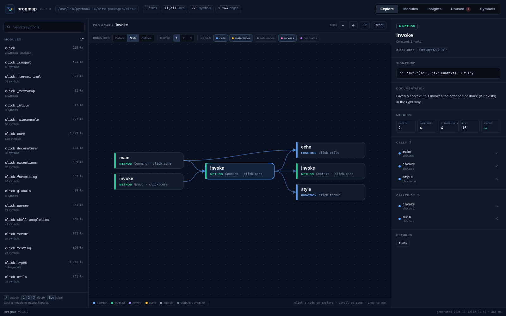
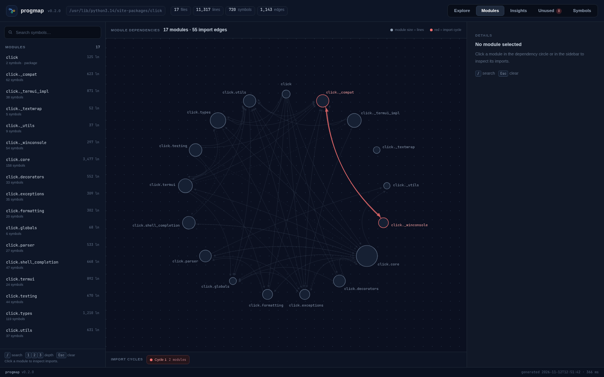
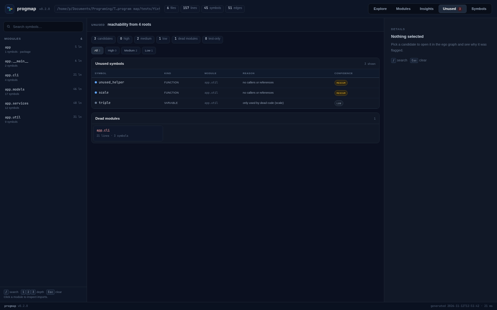
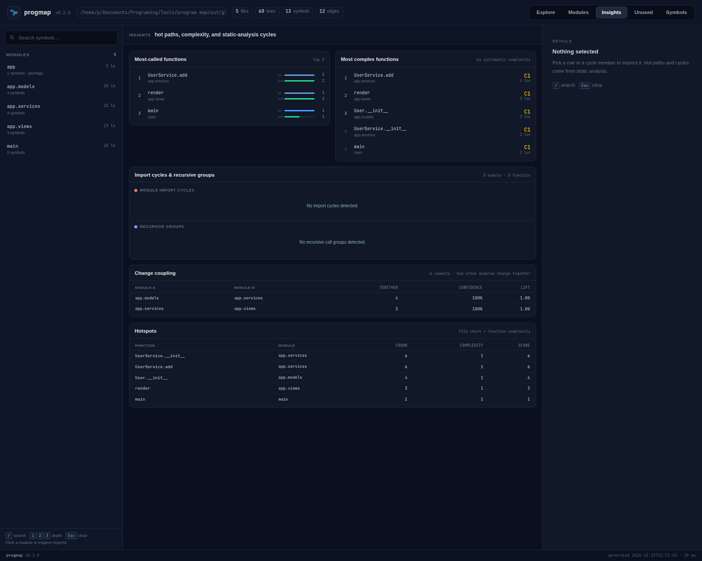

# progmap

A static, **LLM-free** map of a Python codebase: what is defined, what calls what,
what imports what, how classes relate, and where the cycles are — plus a
self-contained interactive explorer you can open straight from disk.

No dependencies. Python 3.10+. Parses with the standard `ast` module.

```bash
pip install -e .                         # optional, gives you the `progmap` command
progmap /path/to/project -o progmap-out
# or, without installing:
python3 -m progmap /path/to/project -o progmap-out
```

Then open `progmap-out/explorer.html`.

**What makes it different**

- **No LLM, no type checker, no build step.** Two AST passes, real lexical
  scoping, and an explicit confidence model.
- **Unused code is evidence, not a verdict.** Every candidate says why and how
  sure the tool is; public API, tests and framework handlers are roots.
- **History is part of the map.** Co-change coupling and hotspots come from git,
  next to the static call graph.
- **One portable HTML file.** No server, no CDN, no telemetry — open it from disk.

```
17 files · 11,317 lines · 720 symbols · 1,143 edges · 400 ms
```

## What you get

| file | what it is |
| --- | --- |
| `explorer.html` | self-contained interactive map — no server, no network, no CDN |
| `map.json` | the whole graph (nodes, edges, metrics, cycles) for your own tooling |
| `report.md` | a human-readable summary: shape, hubs, complexity, cycles, unused code, history |
| `graph.dot` | optional static Graphviz export of the call graph |



## What it maps

Every definition becomes a node (module, class, function, method, nested
function, module/class variable). Every relationship becomes a typed edge:

| edge | meaning |
| --- | --- |
| `calls` | a function/method actually calls another |
| `instantiates` | `Thing(...)` |
| `references` | a function/class/constant is used as a value (callbacks, type hints, aliases) |
| `inherits` | class → base class |
| `decorates` | decorator function → decorated function |
| `imports` | module → module |

The explorer derives the hierarchy (containment, subclasses, callers/callees),
coupling, and cycles from those edges.

## How names are resolved

This is the part that decides whether the map is useful. For each module it:

1. **Indexes** definitions and imports (`indexer.py`).
2. **Binds** module-level names (`binder.py`) — absolute and relative imports,
   aliases, `from pkg import submodule`, `__init__.py` re-exports, star imports,
   `src/` layouts, and package roots (analyzing `click/` yields `click.core`, not
   `core`, so stdlib names can't collide).
3. **Resolves uses** (`resolver.py`) with Python's real lexical scoping:
   locals, params, comprehensions, `global`, closure chains.
4. **Follows attribute chains** `a.b.c` through modules, classes, and bases
   (including `super()` and inherited methods).
5. **Infers receiver types** from annotations, `x = Cls()`, `self.repo = repo`,
   return annotations, and dataclass/class field annotations.

Method calls on a typed parameter resolve to the *declared* method — e.g. a
`user: User` parameter calling `user.describe()` links to `Base.describe` when
that is where it is defined, not to every override.

Deeper design notes and trade-offs: [docs/ARCHITECTURE.md](docs/ARCHITECTURE.md).

## Accuracy and limits

It is a **heuristic binder, not a type checker**. It is deliberately
conservative: unresolved is better than a wrong edge.

- **Dynamic code is invisible**: `getattr`, `exec`, `importlib`, plugin
  registries, metaclasses, DI containers, `*args` dispatch, ORM descriptors.
- **Dispatch is static**: an inherited call resolves to the base implementation;
  overrides are listed separately in the detail panel.
- **Types**: only simple annotations are understood; `Callable[...]`,
  `TypeVar` gymnastics, and unannotated containers usually degrade to "unknown".
- **Conditional definitions** (`if sys.platform...`) resolve to one definition.
- `eval`-time string imports and `.pyi` stubs are not consulted.
- Names it could not resolve at all are counted and listed in the report, so you
  can tell when the map is looking through a hole.
- **Unused analysis is closed-world**: code reached through reflection, plugin
  registries, or a framework's own dispatch can look unused. That is exactly why
  results carry a confidence and a reason and why framework decorators are
  treated as roots.

On `click` (11k LOC) this resolves **0 unresolved names**; its unused report
contains 8 low-confidence platform-specific names and no dead modules. On the
stdlib packages tested (`json`, `asyncio`, `email`) it leaves a handful of
unresolved names, all genuine dynamic uses.

## Explorer

Five views share one selection (deep-linkable via the URL hash):

- **Explore** — ego graph of the selected symbol: callers to the left, callees to
  the right, BFS columns by depth 1–3, edge-kind filters, click to walk the graph.
  Unused symbols are outlined in red with an "unused" note in their details.
- **Modules** — module dependency graph with import cycles highlighted in red;
  type-only (`if TYPE_CHECKING:`) imports are shown dashed and excluded from cycles.
- **Insights** — most-called functions, most complex functions, import cycles,
  recursive groups, and (with git) change coupling + hotspots.
- **Unused** — candidates with reason, confidence and dead modules; click a row
  to see it in the graph.
- **Symbols** — sortable table of everything.

Keyboard: `/` search, `Esc` clear, `1/2/3` change depth.



## Unused code (with evidence)

"Has no callers" is not the same as "unused". `progmap` builds an explicit root
set, sweeps the graph, and reports only what is left — with the reason and a
confidence, never a bare accusation.

Roots are discovered from the code: package entry points and `__init__` exports,
`__all__`, `__main__` modules and `if __name__ == "__main__"` guards, stand-alone
scripts, `[project.scripts]` entry points, tests, and framework-decorated
handlers (`@command`, `@route`, `@fixture`, `@rule`, …). Add your own with
`--root`, or teach it a registration decorator:

```bash
progmap . --root app.cli:main --framework-decorator register_tool
```

Reachability follows calls, instantiations, references, inheritance and imports.
A live class keeps its methods and base classes; a live module keeps its imports
and top-level code; a live method keeps its class. Every candidate carries:

| confidence | meaning |
| --- | --- |
| **high** | private, no callers or references, no dynamic dispatch in the module |
| **medium** | public name, or only reachable from code that is itself unused |
| **low** | module uses `getattr`/`importlib`, platform-specific branches, or ambiguous public API |

Code reached **only from tests** is listed separately, not as dead. Dead modules
are reported once instead of listing all of their symbols.



In a library (no entry points detected) public symbols are treated as API by
default. Use `--no-root-public` to audit public names too, or `--root-public` to
force that behaviour in an application. Tests stop being roots with
`--no-test-roots`.

Project-level defaults can live in `.progmap.json`:

```json
{
  "roots": ["app.cli:main"],
  "root_public": false,
  "exclude": ["tests/*"],
  "framework_decorators": ["register_tool"]
}
```

## History signals

When the directory is inside a git repository, `progmap` also reports:

- **change coupling** — modules that keep changing in the same commits, with
  confidence (how often one implies the other) and lift (vs. chance);
- **churn** per module, and **hotspots** (file churn × function complexity).

Merge commits and commits touching more than 40 modules are skipped. History is
one `git log --name-only` pass, bounded by `--git-commits` (default 1500) and
disabled with `--no-git`.



## Output layout

```
progmap-out/
├── explorer.html
├── map.json
├── report.md
└── graph.dot          # unless --no-dot
```

`map.json` is the stable contract: `meta`, `stats`, `modules`, `symbols`,
`edges`, `hubs`, `complex`, `cycles` (`functions`, `modules`), `module_edges`,
`unresolved`, `dead_code` (`summary`, `roots`, `candidates`, `dead_modules`,
`test_only`) and `git` (`cochange`, `churn`, `hotspots`). Symbol ids look like
`click.core::Command.invoke`; all edges carry `src`, `dst`, `kind`, and the first
`line` where the relationship occurs. `imports` edges may be flagged
`type_only: true` when guarded by `if TYPE_CHECKING:` (not a runtime cycle) or
`lazy: true` when imported inside a function (runtime, but not an import cycle).

## Options

```
progmap PATH [-o OUT] [--exclude GLOB] [--root SYMBOL]
             [--root-public|--no-root-public] [--no-test-roots]
             [--framework-decorator NAME]
             [--git|--no-git] [--git-commits N]
             [--no-dot] [--no-report] [--dot-limit N]
```

- Analyzing a *package directory* uses its name as the module prefix.
- Analyzing a *project directory* finds packages naturally, strips `src/`, and
  respects `.gitignore` via `git ls-files` when available.
- `--exclude 'tests/*'` (repeatable) skips paths.

## Development

```bash
python3 -m unittest discover -s tests -t . -v
```

The suite runs on Python 3.10–3.13 in CI and needs nothing beyond the standard
library.

Layout:

```
progmap/
  discovery.py   find files, assign module names
  indexer.py     AST -> symbols (pass 1)
  binder.py      imports / re-exports / namespaces
  resolver.py    scopes, attribute chains, type inference -> edges (pass 2)
  analysis.py    metrics, SCC cycles, hubs
  deadcode.py    root set, reachability, unused candidates + evidence
  gitsignals.py  churn, co-change coupling, hotspots
  pipeline.py    orchestration + JSON payload
  export/        json, dot, report, html
  assets/        the explorer template
```

The static pipeline is deterministic: same files, byte-identical `map.json`
(except the `generated` timestamp and git history). No AI, no network, no
telemetry.

## Roadmap

- Incremental re-index for large trees; SQLite backend past ~50k symbols.
- Other languages through a SCIP adapter, keeping the core graph model.
- Root-set suggestions from runtime traces or coverage data.
- A `progmap check` mode with budgets (new cycles, new high-confidence dead code).

## License

MIT.
